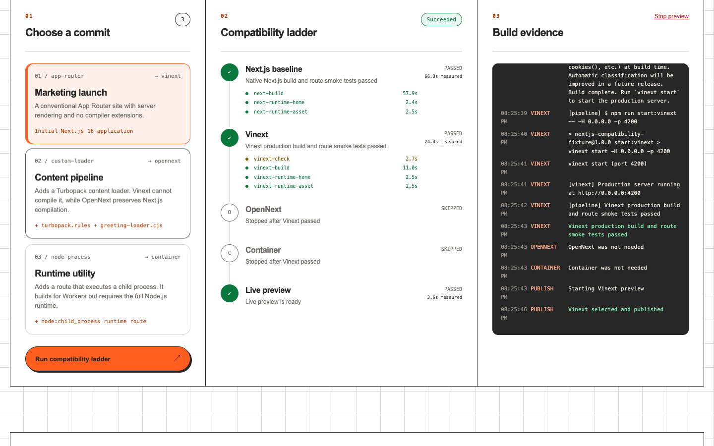
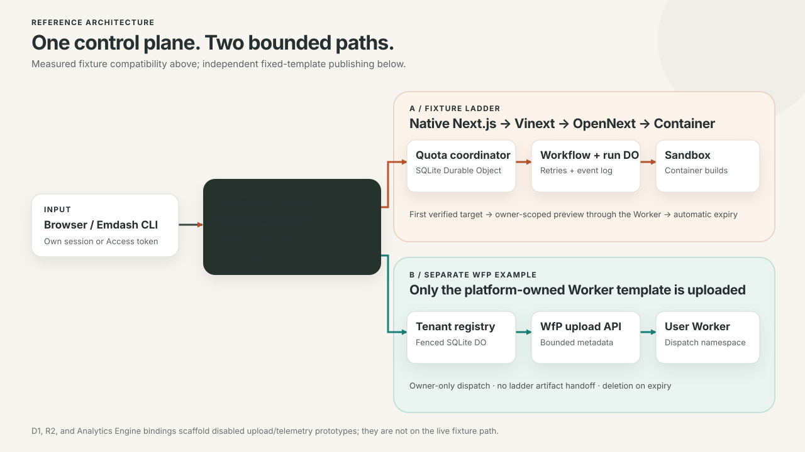
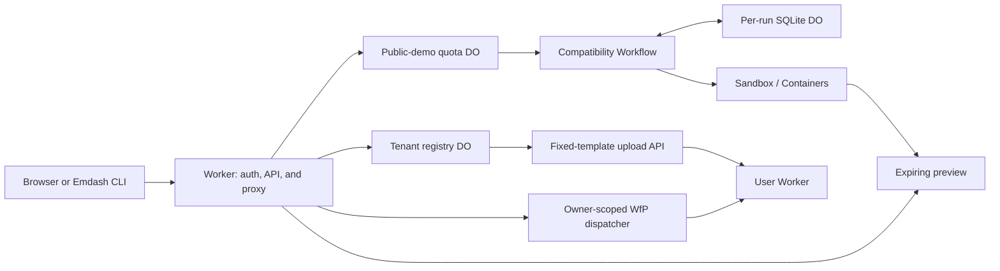

# Cloudflare Next.js Compatibility Demo

[](LICENSE)

> A Cloudflare-powered pipeline that evaluates Next.js applications across native Next.js, Vinext, OpenNext, and a container fallback.

> **Status:** Reference implementation shared as-is. Maintenance and support are best-effort via [GitHub Issues](../../issues).

The control plane runs three bundled Next.js fixtures through a real build-and-smoke-test ladder, then keeps the first verified target available as a short-lived **Sandbox preview**. A separate Emdash / Workers for Platforms example publishes a **fixed Worker template** with bounded metadata. It does not deploy the ladder's generated artifacts.

**[Try the live demo](https://cloudflare-nextjs-compatibility-demo.dwarven.workers.dev/)** · [Fixed-template WfP example](examples/emdash-wfp/README.md)



## Quick example

Run the same fixture matrix locally, without a Cloudflare account:

```sh
npm ci
npm run fixtures:install
VERIFY_CONTAINER=1 npm run fixtures:verify
```

Without Docker, omit `VERIFY_CONTAINER=1` to check the Worker adapters only. The verifier expects `vinext` to pass Vinext, `opennext` to fail Vinext and pass OpenNext, and `container` to fail both Worker adapters before passing as a standalone container. This is build evidence, **not** a production deployment benchmark.

## Contents

- [Architecture](#architecture)
- [Fixtures and features](#fixtures-and-features)
- [Technology](#technology)
- [Prerequisites](#prerequisites)
- [Local verification](#local-verification)
- [Deploy your own control plane](#deploy-your-own-control-plane)
- [Using the demo](#using-the-demo)
- [Demo limits and cleanup](#demo-limits-and-cleanup)
- [Timing and cost model](#timing-and-cost-model)
- [Project structure](#project-structure)
- [Limitations](#limitations)
- [Contributing and license](#contributing-and-license)

## Architecture



The Worker authenticates callers and enforces ownership before touching either lane. A deployment-wide SQLite Durable Object reserves build/publishing capacity, Workflows drive retryable builds and preview cleanup, and tenant-scoped registries fence WfP changes. The returned preview is proxied from a Sandbox; the WfP route dispatches only an owner-authorized fixed-template User Worker.

<details>
<summary>Architecture as Mermaid</summary>



</details>

## Fixtures and features

| Fixture ID  | Example change                       | Expected first compatible target |
| ----------- | ------------------------------------ | -------------------------------- |
| `vinext`    | Conventional App Router site         | Vinext                           |
| `opennext`  | Turbopack content loader             | OpenNext for Cloudflare          |
| `container` | Route requiring `node:child_process` | Standalone Next.js container     |

Each run starts with a native Next.js baseline, then tries Vinext, OpenNext, and the container in order. The stage runner prepares isolated workspaces and records build results, route checks, and logs; the Workflow stops at the first verified match. The UI streams events via a per-run Durable Object WebSocket and shows observed decision/preview timings next to an explicitly modeled cost scenario.

Visitors can cancel their own run, inspect their own events, and open their own preview. The separate [Emdash / WfP example](examples/emdash-wfp/README.md) supports owner-scoped publish, update, list, dispatch, and delete operations for its fixed template.

## Technology

| Layer              | Implementation                                                                                                             |
| ------------------ | -------------------------------------------------------------------------------------------------------------------------- |
| UI and HTTP API    | TypeScript Cloudflare Worker, browser JavaScript, Zod validation                                                           |
| Job and state      | Cloudflare Workflows, SQLite-backed Durable Objects                                                                        |
| Builds and preview | Cloudflare Containers, `@cloudflare/sandbox@0.13.0-next.751.1` (1.0 preview line), nested rootless Docker for the fallback |
| Fixture adapters   | Next.js 16.3.3, Vinext 1.0.0-beta.8, `@opennextjs/cloudflare` 1.20.4                                                       |
| Separate publisher | Workers for Platforms dispatch namespace and platform-owned User Worker                                                    |
| Checks             | Vitest, TypeScript, Prettier, local fixture runner                                                                         |

The Dockerfile pins public Node, Debian, Docker, and `cloudflare/sandbox:next-musl` images by digest. The controlled container fallback pins its Node runtime image on `mirror.gcr.io` so anonymous Sandbox builds do not depend on Docker Hub's shared pull quota. Keep the Sandbox npm package and base image on the **same preview line** when upgrading; the stable Sandbox API is different. See [Sandbox 1.0 preview](https://developers.cloudflare.com/sandbox/1-0-preview/).

## Prerequisites

- Node.js 24 and npm for parity with the image; Docker with a working daemon for container verification and the Dockerfile-backed deploy.
- For deployment: a Cloudflare account with Workers Paid, Containers/Sandbox, Workflows, SQLite Durable Objects, and Workers for Platforms available. Wrangler authentication must target the intended account.
- A dedicated dispatch namespace, R2 bucket, and D1 database for the bindings in `wrangler.jsonc`. The D1/R2/Analytics bindings are scaffolding for **disabled** upload/telemetry prototypes, but the current Wrangler config still declares them. Cloudflare Analytics Engine uses the dataset name in the config.
- To enable the fixed-template publisher: a server-only token scoped to that account and authorized for dispatch-script creation and deletion. The [WfP upload API](https://developers.cloudflare.com/api/resources/workers_for_platforms/subresources/dispatch/subresources/namespaces/subresources/scripts/methods/update/) lists `Workers Scripts Write` as its accepted permission. Cloudflare's [current Workers roles](https://developers.cloudflare.com/workers/authorization/workers/) distinguish editing existing Workers from creating/deleting them, which requires product-level `Admin` for role-based tokens. Validate the token against a dedicated staging Worker and namespace before enabling public mutations. Public-demo sessions also need a random `DEMO_SESSION_KEY` of at least 32 characters. See [Worker secrets](https://developers.cloudflare.com/workers/configuration/secrets/).

Check current [Containers limits](https://developers.cloudflare.com/containers/platform/limits/), [Workflows limits](https://developers.cloudflare.com/workflows/reference/limits/), and [WfP limits](https://developers.cloudflare.com/cloudflare-for-platforms/workers-for-platforms/reference/limits/) before sizing or enabling traffic. The limits below are this **sample's** policy, not platform limits.

## Local verification

```sh
npm ci
npm run fixtures:install
npm run check
npm run fixtures:verify
VERIFY_CONTAINER=1 npm run fixtures:verify
```

`npm run check` runs typechecking, Prettier, and the Worker-backed Vitest suite. The local fixture runner exercises the native/Vinext/OpenNext paths and, with `VERIFY_CONTAINER=1`, requires an unrestricted Docker daemon for the container path. `npm run release:check` also runs dependency audits. Local fixture verification does not require account resources or an API token.

## Deploy your own control plane

The tracked `wrangler.jsonc` is an example, **not a live account configuration**. Keep account-specific IDs and image references in an ignored `wrangler.local.jsonc`; keep secrets in Wrangler, never in either config. `npm run dev` and `npm run deploy` use this local config; `npm run cf-typegen` uses the sanitized tracked template. Check that the Worker name, Workflow name, namespace, bucket, and database will not replace existing resources in your account before creating anything.

1. Authenticate Wrangler and check the intended account and existing names:

   ```sh
   npx wrangler whoami
   npx wrangler dispatch-namespace list
   npx wrangler r2 bucket list
   npx wrangler d1 list
   ```

   Check Workers in the dashboard for a name collision. Use dedicated names if any default is already occupied. If you change the dispatch namespace, update **both** namespace fields in `wrangler.local.jsonc` and the server-side allowlist `WFP_DISPATCH_NAMESPACE` in `src/wfp-environments.ts`; callers cannot choose the namespace. If you change the Worker name, change the Workflow name too.

2. Create the default-named resources **only if they do not already belong to another deployment**:

   ```sh
   npx wrangler dispatch-namespace create nextjs-compatibility-environments
   npx wrangler r2 bucket create cloudflare-nextjs-compatibility-artifacts
   npx wrangler d1 create cloudflare-nextjs-compatibility-demo
   ```

   Decline automatic edits to the tracked Wrangler file if prompted. Workflows and Durable Object namespaces are declared in the Worker config and created during deployment; Analytics Engine is bound by its dataset name.

3. Copy `wrangler.jsonc` to **`wrangler.local.jsonc`**. In the local copy, set top-level `account_id` to the account selected by `whoami`, set `vars.CLOUDFLARE_ACCOUNT_ID` to that same ID for the WfP API, replace `d1_databases[0].database_id` with the ID returned by D1, and reconcile every resource name with step 1. Apply the included prototype schema to this dedicated database:

   ```sh
   npx wrangler d1 migrations apply PIPELINE_DB --remote --config wrangler.local.jsonc
   ```

4. Choose **one** authentication mode in the local config:

   | Setting                  | Hosted anonymous demo | Access-protected self-hosted app |
   | ------------------------ | --------------------- | -------------------------------- |
   | `PUBLIC_DEMO`            | `true`                | `false`                          |
   | `REQUIRE_ACCESS`         | `false`               | `true`                           |
   | `DEMO_MUTATIONS_ENABLED` | `false` initially     | Not used                         |

   For Access mode, protect the Worker with a Cloudflare Access application **before** making the route reachable. `REQUIRE_ACCESS=false` without `PUBLIC_DEMO=true` is only for local development's shared synthetic identity; do not expose it publicly. Keep `UPLOADS_ENABLED` and `PUBLISHING_ENABLED` set to `false`: they refer to unfinished arbitrary-source/site prototypes, **not** to the fixed-template WfP publisher.

5. Dry-run and deploy the Dockerfile-backed Worker with mutations paused:

   ```sh
   npx wrangler deploy --dry-run --config wrangler.local.jsonc
   npx wrangler deploy --config wrangler.local.jsonc --containers-rollout=immediate
   ```

   Wrangler builds and pushes the `./Dockerfile` image when it deploys this config. If your network requires a custom CA unavailable to Wrangler's BuildKit invocation, point `NODE_EXTRA_CA_CERTS` to a local combined PEM bundle and build/push separately:

   ```sh
   docker buildx build --platform linux/amd64 --provenance=false --load \
     --secret id=build_ca,src="$NODE_EXTRA_CA_CERTS" \
     -t nextjs-compatibility-sandbox:ca-build .
   npx wrangler containers push nextjs-compatibility-sandbox:ca-build \
     --config wrangler.local.jsonc
   ```

   Set only the **ignored local** config's `containers[0].image` to the returned registry image before deploying. The CA is mounted only during the build; keep its file and the account-specific image name out of the repository.

6. In public-demo mode, add Worker secrets interactively, never as arguments or source literals:

   ```sh
   npx wrangler secret put DEMO_SESSION_KEY --config wrangler.local.jsonc
   npx wrangler secret put WFP_API_TOKEN --config wrangler.local.jsonc
   ```

   Verify `/health`, the home page, response security headers, and separate browser sessions. After the token and dedicated namespace are confirmed, set `DEMO_MUTATIONS_ENABLED` to `true` **in the ignored local config**, redeploy with the command above, and verify all three fixture paths and WfP publish/update/list/dispatch/delete. Confirm automatic preview and environment expiry before sharing the URL. Changing the flag back to `false` pauses new runs/uploads while owner deletes and cleanup alarms continue.

Regenerate committed Worker types from the **sanitized template** after changing bindings (`npm run cf-typegen`); do not commit generated types from an account-specific local config. There is no Deploy to Cloudflare button because containers, WfP, credentials, and optional Access require manual setup.

## Using the demo

Open the deployed home page, select one of the three fixtures, then **Run compatibility ladder**. The run's event stream and comparison update as builds finish; a passing target yields an owner-scoped `/api/runs/{runId}/preview/` route. **Stop preview** cancels it early. The Worker only accepts those three fixture IDs and does not accept source archives through any hosted route.

For the separate publisher, set `COMPATIBILITY_CONTROL_PLANE_URL` in your terminal to the **verified Worker origin**, then use the bundled manifest:

```sh
export COMPATIBILITY_AUTH=demo
npm run emdash:publish -- examples/emdash-wfp/environment.example.json
npm run emdash:list
npm run emdash:delete -- customer-preview
```

`COMPATIBILITY_AUTH=demo` is the CLI default. It obtains an expiring anonymous session and stores its cookie with owner-only filesystem permissions under `~/.config/nextjs-compatibility-demo/session.json`. For an Access-protected installation, set `COMPATIBILITY_AUTH=access`; the CLI uses `cloudflared access token` or the optional `COMPATIBILITY_ACCESS_TOKEN`. The WfP API token stays **only on the Worker**. The returned WfP URL requires the same visitor session or Access principal; it is not an unauthenticated public customer link. See the [example contract](examples/emdash-wfp/README.md).

## Demo limits and cleanup

These defaults are enforced atomically by `PublicDemoCoordinator` in public-demo mode; the self-hosted Access mode uses its separate tenant-registry limits.

| Operation                   | Public-demo policy                                                 |
| --------------------------- | ------------------------------------------------------------------ |
| Active Sandboxes            | 3 globally; 1 per session                                          |
| New runs                    | 3/session/hour; 5/IP/hour; 10 globally/hour; 30 globally/day       |
| Build and verified preview  | 30-minute overall build deadline; then up to 30 minutes of preview |
| Published WfP environments  | 1/session; 10 globally; 30-minute lifetime                         |
| WfP publish/update attempts | 3/session/minute; 5/IP/hour; 20 globally/hour; 50 globally/day     |
| Visitor sessions            | 2-hour cookie; 10 new sessions/IP/hour; 500 globally/day           |
| WfP dispatch                | 120/principal/minute, 300 globally/minute                          |

Requests and previews have additional per-session/IP/global throttles; exhaustion returns a status and `Retry-After` when applicable. On cancellation or expiry, the Workflow/coordinator terminates the job and destroys its Sandbox before returning capacity. After confirmed teardown, the per-run event record expires two hours later; completed Workflow execution state uses its separately configured seven-day retention. Uncertain WfP API outcomes and failed deletions retain a reservation and retry cleanup rather than silently declaring the resource gone. The registry reserves headroom from its account API budget for expiry work.

## Timing and cost model

- **Evaluation time** comes from each stage runner's workspace preparation, build, and smoke checks. **Click-to-decision** and **verified preview** are observed wall-clock times for this run; neither is a production rollout measurement.
- **Pipeline cost** is a modeled gross overage-rate range for the observed `standard-1` Sandbox window: provisioned memory/disk at the low end, and 100% of its 0.5 vCPU at the high end. The optional 30-minute preview hold is shown separately.
- **Monthly runtime cost** uses a versioned reference workload (10 million requests, explicit CPU/container assumptions) and published rate cards. It is not inferred from build time or a customer's invoice. Included usage, other products, and some meters are excluded or shown as unavailable.
- The WfP example reports **its own** per-upload duration; no seed-to-live claim or ladder-to-WfP artifact handoff is implied.

See `src/comparison.ts` and `src/costs.ts` for the models and the source links returned by the API. Recheck [Workers](https://developers.cloudflare.com/workers/platform/pricing/), [Containers](https://developers.cloudflare.com/containers/platform/pricing/), and [Workers for Platforms](https://developers.cloudflare.com/cloudflare-for-platforms/workers-for-platforms/reference/pricing/) pricing before using any estimates in planning.

## Project structure

```text
src/index.ts                 Worker HTTP routes, auth, preview and WfP dispatch
src/public-demo.ts           Anonymous sessions, global budgets, expiry alarms
src/workflow.ts              Baseline/adapter ladder and preview lifecycle
src/run-durable-object.ts    Per-run event log and WebSocket state
src/environment-registry.ts Tenant-scoped WfP registry and API budget
src/wfp-environments.ts      Fixed-template publisher and dispatcher
src/comparison.ts            Measured timings and modeled prices
public/                      Browser shell, styles, and client script
runner/                      Isolated stage runner and local matrix verifier
fixtures/                    Base Next.js source and three controlled variants
examples/emdash-wfp/         Manifest and CLI usage contract
migrations/                  D1 schema for disabled prototype features
test/                        Worker-backed Vitest tests
docs/architecture.svg        Repository/garden architecture artwork
docs/compatibility-ladder.png Verified public-demo screenshot
```

## Limitations

- No arbitrary project uploads, generated-source deployment, or production adapter rollout is exposed. `src/upload-*`, `src/source-archive.ts`, D1, R2, and Analytics Engine contain **prototype scaffolding** and are not active in the hosted fixture flow.
- The container target is a Next.js standalone server inside a nested Docker runtime. A passing route-level test establishes compatibility with this controlled fixture, not parity for every application.
- WfP environments are owner-scoped fixed-template HTML Workers; this example does not host Emdash's Electron desktop or SSH workspace. A public customer-facing route would need a separate authorization and tenant-routing design.
- A successful update upload can precede the new metadata becoming visible through WfP dispatch; one staging update served its previous version for roughly 78 seconds. Confirm the routed content before declaring an update live. The [instant-dispatch guarantee](https://developers.cloudflare.com/changelog/post/2025-02-20-synchronous-uploads/) applies to **first-time uploads**, and the example's `durationMs` measures only the upload API call.
- The Sandbox SDK dependency is a pinned **preview** release; validate its matching base image, pricing, and behavior before upgrading or reusing this code in production.

## Contributing and license

See [CONTRIBUTING.md](CONTRIBUTING.md) for the development workflow and [SUPPORT.md](SUPPORT.md) for best-effort help. Security reports should follow [SECURITY.md](SECURITY.md), and community interactions follow the [Code of Conduct](CODE_OF_CONDUCT.md).

Licensed under [MIT](LICENSE). Thanks to the teams behind [Next.js](https://nextjs.org/), [Vinext](https://vinext.dev/), [OpenNext](https://opennext.js.org/cloudflare), and the [Cloudflare Developer Platform](https://developers.cloudflare.com/workers/).
